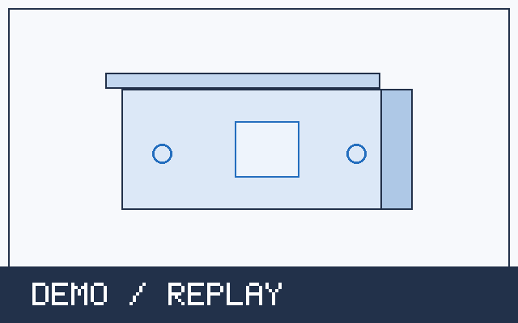
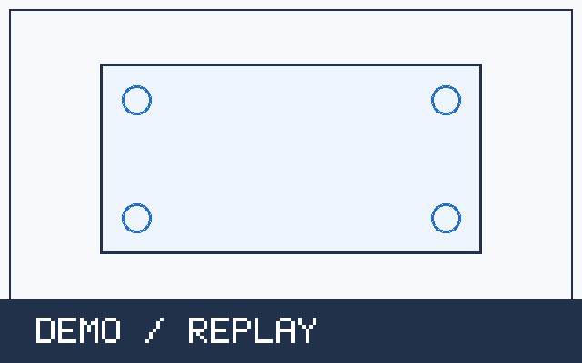

# industrial-cad-agent-showcase

A two-entry industrial CAD workflow replay: concept clarification and
drawing inspection, with revision-bound confirmation and explicit evidence.

> **DEMO / REPLAY only - NOT FOR MANUFACTURING.** The commands use fixed
> synthetic fixtures and pre-generated preview images. They do not generate
> CAD from arbitrary drawings. The private CAD engine is not included.

| Concept entry: synthetic sensor bracket | Drawing entry: synthetic plate |
|---|---|
|  |  |
| [Original 2D DEMO SVG](examples/concept_to_manufacturing/concept-preview-2d.svg) | [Original 2D DEMO SVG](examples/drawing_to_deliverable/deliverable-preview-2d.svg) |

Both image groups are illustrative replay assets. Neither is a measured,
dimensioned or geometry-verified CAD deliverable.

## Run from source

The first release is prepared as a GitHub source repository and its
tag-matched source snapshot. Use CPython 3.12 from the repository root, keeping
`cad_agent_showcase/`, `fixtures/` and `examples/` together. The replay commands
use the Python standard library and require no installation or network access.
Distribution mode is source display with rights retained as described below.

```text
python -m cad_agent_showcase demo concept --replay
python -m cad_agent_showcase demo drawing --replay
python -m cad_agent_showcase demo confirmation-mutation --replay
```

| Command | Replay behavior | Expected exit |
|---|---|---|
| `concept` | UNKNOWNs, assumptions, parameter supplement, new revision, confirmation and replay delivery | 0 |
| `drawing` | Declared synthetic DXF summary, unknown objects, parameter supplement, confirmation and replay delivery | 0 |
| `confirmation-mutation` | Invalidation, stale delivery, reuse, rejection, new revision continuation and duplicate execution | 0 when all expected scenarios match |

Each valid replay invocation prints a JSON envelope. Successful delivery writes
its bundle under `demo-output/<command>/`; use `--out DIR` to change the output
location. Expected negative scenarios in `confirmation-mutation` are reported
inside an otherwise successful scenario check.

The envelope identifies `mode=replay`, `engine=ReplayEngine` and
`evidence_type=replay`. Delivery readback checks manifest fields, declared
fixture data and artifact hashes. The flags `manufacturing_release`,
`engineering_approval`, `production_approved` and `verified_truth` remain false.

Existing wheel and sdist files are internal audit artifacts, not first-release
attachments. Standalone wheel use, `pip install` and PyPI publication are not
supported release paths. See [Portability](docs/portability.md).

## Workflow

- Concept requests retain unknown dimensions and materials as `UNKNOWN`.
- Fixed concept candidates label assumptions separately from supplied values.
- A parameter supplement creates a new task revision and invalidates the old
  confirmation.
- Drawing inspection covers the declared synthetic DXF subset. Unknown entity
  types are listed rather than interpreted as engineering features.
- Confirmation binds task revision, input, parameters, assumptions, candidate
  and delivery specification. The events are simulated replay events, not real
  user or host receipts.
- Delivery emits DEMO media, a manifest, parameter provenance and readback.

```text
CONCEPT_DRAFT -> NEED_PARAMETERS -> PARAMETERS_READY
  -> CONFIRMATION_REQUIRED -> CONFIRMED -> REPLAY_DELIVERED

DRAWING_INSPECTED -> NEED_PARAMETERS -> CONFIRMATION_REQUIRED
  -> CONFIRMED -> REPLAY_DELIVERED

input/parameter change -> new revision; old confirmation -> CONFIRMATION_INVALIDATED
user rejection        -> CONCEPT_ONLY_CLOSED / DESIGN_ONLY_CLOSED
unsupported input     -> STOPPED + explicit error code
```

The two entries execute independently. The public replay does not model CAD,
verify geometry, measure arbitrary drawings or call a private engine, OCP,
PyMuPDF or a host agent. Its results cannot establish engineering approval,
design verification, production readiness or manufacturing release.

## Refusals and failures

```text
python -m cad_agent_showcase demo reject --case missing-parameters --replay
python -m cad_agent_showcase demo reject --case out-of-range --replay
python -m cad_agent_showcase demo reject --case unknown-format --replay
```

These three deliberate refusals each exit 1 with a distinct code and no delivery.
For the engine-failure branch:

```text
python -m cad_agent_showcase demo concept --replay --fail-engine
```

| Exit | Status | Meaning |
|---|---|---|
| 0 | OK | Replay delivery or expected scenario check completed. |
| 1 | REJECTED | Explicit refusal, invalidated/reused confirmation, user rejection or duplicate delivery. |
| 2 | INPUT_ERROR | Invalid invocation, fixture-integrity problem or other input error. |
| 3 | ENGINE_FAILURE | Injected replay engine failure; no deliverable is written. |

Argparse usage errors, including an invalid `--case`, exit 2 with usage text
and no JSON envelope. This differs from a valid refusal invocation.

## Tests and platform evidence

The source includes **26 standard-library unittest tests**:

```text
python -m unittest discover -s tests -t .
```

They cover routing, UNKNOWN preservation, confirmation binding/invalidation,
replay outputs and CLI outcomes. The 2026-11-11 B3 review recorded 26/26 in its
local Windows source-copy rerun. That historical result does not validate the
revised release commit, Git checkout behavior or real GitHub Actions.

Windows source-copy results are historical local evidence. Linux is **NOT_RUN**;
no Linux support is claimed. The Windows/Linux CI matrix is a validation target,
not a passed run. Release closeout separately requires exact-commit Git checkout
checks for byte-bound DXF fixtures and correct CI failure propagation. See
[Portability](docs/portability.md) for the evidence limits.

## Review and release status

Historical source: the delegated AI review of `B3-20261111-v1`, dated
2026-11-11, decided **APPROVED for the original local B3-RC only**. It reviewed
the original 58-file tree:

```text
tree_sha256: 8e0cb71bd06da83fc739350d30a96768f952908b60ddf71b7679f9590e540d1c
review_report_sha256: 78d0f30938fe2e125ee81df5e6c29bc142f8b70b4154850e85d945d0dd6adbaa
```

The original report is retained outside the public source tree. It discloses
same-model review with prior B1/B2 context: it was not a fresh review or
third-party independent verification. It did not approve publication, a license,
real CI, Linux support or engineering use. Original `independent_review: not_run`
text records the author's earlier point in time; it does not erase that later,
limited historical review.

This documentation revision changes the reviewed tree. The old decision does
not cover it. The revised release candidate needs its own exact-object review.
For this release-closeout documentation candidate:

```text
public_replay: source_release_candidate
independent_review: pending
public_release_ready: false
publication_evidence: not_recorded_for_this_candidate
real_github_actions: not_run
linux_tested: not_run
license: source-display-no-open-source-license
private_engine_demo: not_run
consumer_chain: not_evaluated
production_approval: false
manufacturing_release: false
```

These states do not make a claim about unrelated remote repositories or account
activity. Public replay checks remain separate from private engine/C1 work,
real A/B closure and engineering contracts.

## Source layout and documentation

```text
cad_agent_showcase/       orchestration, contracts, confirmation, replay engine
fixtures/                two synthetic fixture groups and declared digests
examples/                existing pre-generated DEMO SVG and PNG media
demo/                    thin CLI wrappers
tests/                   26 standard-library unittest tests
docs/                    architecture, scope, evidence and release notes
tools/build_demo_media.py deterministic standard-library media generator
```

Both fixture groups were created for this demo. The hand-written DXF contains
LINE, CIRCLE and TEXT plus a deliberately unknown SPLINE. The previews come
from `tools/build_demo_media.py`; replay copies existing media rather than
generating CAD. No real project data is needed to run the demo.

- [Architecture](docs/architecture.md)
- [Public scope and limits](docs/public_scope_and_limits.md)
- [Evidence map](docs/evidence_map.md)
- [Private engine boundary](docs/private_engine_boundary.md)
- [Portability](docs/portability.md)

## Rights

Current mode: `source-display-no-open-source-license`. Source is intended for
public capability display; no MIT, Apache-2.0 or other standard open-source
license is granted. All rights are reserved except as provided by law,
applicable platform terms or another explicit agreement. GitHub public viewing
and forking rights under its applicable terms remain unaffected.

This mode follows delegated decision `CAD-PUBLIC-CLOSEOUT-20261113-R0-r1`,
D02, dated 2026-11-14. It is not a legal ownership determination or acceptance
of this candidate's technical or release status. No rights to private engines
or real project data are granted. See the current terms in the historically
named [LICENSE-PENDING.md](LICENSE-PENDING.md), [NOTICE](NOTICE.md) and
[Rights and sources](RIGHTS-AND-SOURCES.md).
