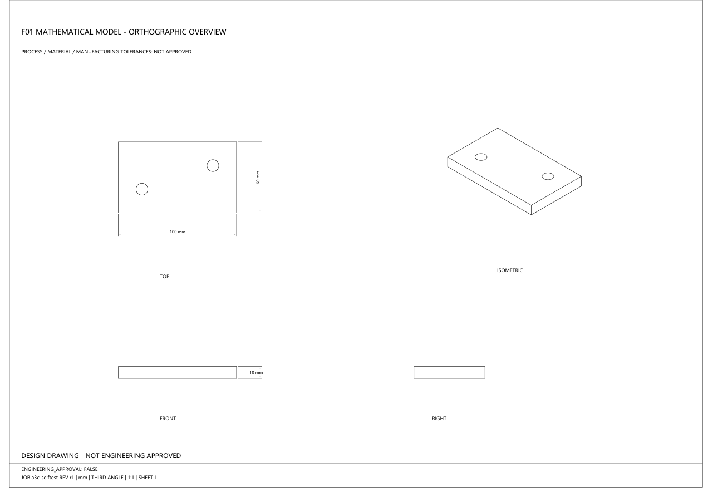

# Industrial CAD Agent Showcase

**工业 CAD 双入口智能设计与制图**

Industrial CAD Agent Showcase brings together multi-agent concept design and drawing reconstruction in a Python CAD workflow. Its local implementation combines structured parameters, scene-based visualization, real STEP/DXF/PDF generation, and file readback checks.

Industrial CAD Agent Showcase 将多智能体概念设计与图纸复建组织进同一套 Python CAD 工作流。本地实现涵盖结构化参数、场景驱动可视化、真实 STEP/DXF/PDF 生成及文件回读核对。

[Public repository / 公开仓库](https://github.com/SnowEagle-Kn/industrial-cad-agent-showcase) · [Runnable replay v0.1.0 / 可运行回放包](https://github.com/SnowEagle-Kn/industrial-cad-agent-showcase/releases/tag/v0.1.0)

The [standalone showcase](docs/showcase/index.html) is included as a local HTML file. Download the repository, keep the `docs/showcase/` directory intact, and open `index.html` in a browser.

[独立展示页](docs/showcase/index.html)以本地 HTML 文件随仓库提供。下载仓库后，保留完整的 `docs/showcase/` 目录，用浏览器打开其中的 `index.html`。

## Overview / 项目概览

The project connects design decisions to concrete artifacts: alternative concepts and visual presentations at the concept stage; feature models, CAD files, and drawings at the modeling stage. It records where dimensions came from, which version was selected, and which files belong to that version.

项目将设计决策连接到具体成果：概念阶段形成备选方案与可视化图册，建模阶段形成特征模型、CAD 文件和图纸；同时记录尺寸来源、选定版本，以及每份文件对应的输入。

### Concept Design / 概念设计入口

Start with a natural-language brief or reference images. The implemented workflow organizes five design seats, anonymous comparison and a fresh judging context, followed by candidate selection and scene-based visualization. Its checks cover six dimensions of design diversity, seven scoring criteria, uncertainty, and sensitivity.

从自然语言需求或参考图片开始。已实现的工作流组织五席设计、匿名比较与新上下文评选，再衔接选案和场景驱动可视化；检查涵盖六维方案差异、七项评分标准、不确定性和敏感性。

The rendering implementation produces multiple views from one scene and supports PNG, GLB, PDF sheets, and self-contained HTML. A parameter bridge converts eligible design data into the feature graph used by the CAD backend.

渲染实现由同一个场景生成多视图，支持 PNG、GLB、PDF 图册和自包含 HTML；参数桥把满足要求的设计数据转换成 CAD 后端使用的特征图。

### Drawing Reconstruction / 图纸复建入口

Start with supported DXF or calibrated vector PDF inputs. The drawing route inventories source objects, records their interpretation and review, and connects eligible features to development modeling. A synthetic drawing-input case has produced an actual four-view design drawing through this route.

从支持的 DXF 或经校准的矢量 PDF 开始。图纸链登记原图对象、解释和复核记录，再把符合要求的特征接入开发建模；已有合成原图样例通过这条链生成了真实的四视图设计图。

The local geometry backend constructs supported plate features, writes real STEP models and native DXF/PDF drawings, then reads files back for geometry, dimension, and consistency checks. Existing development outputs provide concrete files to inspect.

本地几何后端构造受支持的板件特征，写出真实 STEP 模型和原生 DXF/PDF 图纸，再回读文件核对几何、尺寸和一致性。已有开发产物提供了可以实际打开检查的文件。

Synthetic development cases include 100-hole and 256-hole plates, with real model files, native DXF dimensions, and multi-page PDF drawings. The drawing implementation supports A2/A1/A0 layouts, model-bound dimension detail sheets, and declared annotation surfaces.

合成开发案例包括 100 孔与 256 孔板件，已有真实模型文件、原生 DXF 尺寸和多页 PDF 图纸。出图实现支持 A2/A1/A0 图幅、绑定模型的尺寸详情页和声明式标注面。

| Two-hole plate drawing / 双孔板出图 | Repeated-hole plate detail / 重复孔板局部图 |
|---|---|
|  |  |

Actual development output from a synthetic two-hole plate. The original drawing labels are preserved.

合成双孔板件的真实开发出图，保留原图面标识。

The second image is a 450 x 350 pixel lossless PNG crop of the isometric view in a synthetic 100-hole plate development drawing. The source drawing is labeled `DEVELOPMENT FIXTURE / NOT FOR MANUFACTURE`. Its full sheet contains overlapping view regions and is retained internally for provenance; showing this detail does not establish that the original full-sheet layout has been repaired.

第二张图是合成百孔板开发出图中等轴测视图的局部摘图，为 450 x 350 像素无损 PNG 裁切。源图标有 `DEVELOPMENT FIXTURE / NOT FOR MANUFACTURE`。原完整图含视图区交叠，仅作内部来源保留；展示此局部不代表原完整图排版已经修复。

Both images are safe synthetic development materials and do not represent a real customer's end-to-end delivery or manufacturing approval. See [media provenance and inclusion scope](docs/showcase/MEDIA.md).

两图均为安全合成开发素材，不代表真实客户整链交付或制造批准，详见[素材来源与准入范围](docs/showcase/MEDIA.md)。

### Engineering Work / 工程实现

The implementation spans Python workflow orchestration, multi-agent coordination, geometry and rendering, parameter provenance, revision binding, and file-level verification. Upstream changes invalidate stale confirmations and downstream records, so the delivery remains connected to the selected inputs and version.

工程实现覆盖 Python 工作流编排、多 Agent 协同、几何与渲染、参数来源、版本绑定和文件级核对。上游信息变化会使过期确认及下游记录失效，让交付文件持续对应选定输入与版本。

The public repository makes a reproducible part of this work available: a standard-library Python replay of two synthetic workflows, their refusal paths, confirmation invalidation, and delivery evidence. The current public replay package is a selected demonstration of the broader local project.

公开仓库提供其中可复现的一部分：用 Python 标准库回放两个合成工作流，以及拒绝路径、确认失效和交付证据。当前公开回放包是完整本地项目的选定展示部分。

## Technical Details / 技术说明

### Technical Summary / 技术摘要

Industrial CAD Agent Showcase is a dual-input industrial CAD project implemented in Python. Its concept path provides multi-agent design orchestration, anonymous candidate evaluation, seven-state parameter evidence, and deterministic scene-based visualization. Its drawing path inventories and reviews supported DXF or calibrated vector PDF objects before feature modeling. An OCP/OCCT-based local backend constructs B-Rep geometry for profile extrusion, through circular holes, closed slots, and repeated instances; it generates real STEP, native DXF, and PDF artifacts with file readback checks. Revision-bound confirmations, source-to-feature links, and delivery manifests connect decisions to outputs. These capabilities are supported by implementation and bounded synthetic development cases; the downloadable v0.1.0 package separately provides a deterministic workflow replay.

Industrial CAD Agent Showcase 是一个使用 Python 实现的双入口工业 CAD 项目。概念链提供多 Agent 设计编排、匿名候选评选、七态参数证据和确定性的场景驱动可视化；图纸链对支持的 DXF 或经校准的矢量 PDF 对象进行取数和复核，再进入特征建模。本地 OCP/OCCT 后端构造轮廓拉伸、通圆孔、闭合腰槽和重复实例的 B-Rep 几何，生成真实 STEP、原生 DXF 和 PDF，并进行文件回读核对。绑定版本的确认、来源到特征的关联及交付清单连接设计决策和输出。上述能力有实现和限定合成开发案例支撑；另行提供下载的 v0.1.0 包用于确定性工作流回放。

### Implementation and Evidence / 实现与依据

| Component / 组成 | Implemented work / 已实现内容 | Evidence scope / 依据范围 |
|---|---|---|
| Concept workflow / 概念工作流 | Five-seat orchestration, anonymous evaluation, diversity and scoring checks / 五席编排、匿名评选、差异和评分检查 | Workflow and validation code / 工作流及校验代码 |
| Scene renderer / 场景渲染 | Multi-view PNG, GLB, PDF sheets, HTML / 多视图 PNG、GLB、PDF 图册、HTML | Renderer implementation / 渲染器实现 |
| Drawing route / 图纸链 | Source-object inventory, review binding, development-model integration / 原图对象账、复核绑定、开发建模接线 | Implementation and a synthetic drawing-input output / 实现及合成原图出图样例 |
| Geometry backend / 几何后端 | Four supported feature operations, real STEP/DXF/PDF, file readback / 四操作、真实 STEP/DXF/PDF、文件回读 | Code and existing synthetic development artifacts / 代码与既有合成开发产物 |
| Traceability / 可追溯性 | Parameter evidence, revision binding, invalidation, manifests / 参数证据、版本绑定、失效、清单 | Local implementation; selected mechanisms replayable publicly / 本地实现，部分机制可公开回放 |
| Public package / 公开包 | Deterministic CLI replay and refusal tests / 确定性命令行回放与拒绝测试 | Dated v0.1.0 source and CI / 有日期的 v0.1.0 源码与 CI |

The current modeling scope is a bounded plate-feature subset. Drawing intake covers a declared ASCII DXF R2004 XY subset and calibrated vector PDF workflows. Real drawing tasks retain a review/development gate; complete real-user drawing-to-final-delivery acceptance remains outstanding. Fresh host-session orchestration also requires host-level execution evidence. Development artifacts carry their original status and require engineering review before manufacturing use.

当前建模范围为限定的板件特征子集。图纸接入覆盖声明的 ASCII DXF R2004 XY 子集与经校准的矢量 PDF 流程。真实图纸任务保留复核/开发门，真实用户从原图到最终交付的整链验收仍待完成；新宿主会话编排也需要宿主层执行证据。开发产物保留原有状态，制造使用前须经过工程审查。

### Local CAD Outputs / 本地 CAD 产物

| Artifact / 产物 | Purpose / 用途 |
|---|---|
| `model.step` | A real 3D model written by the geometry backend / 几何后端写出的真实三维模型 |
| `model.dxf`, `drawing.dxf` | Model/drawing views and native drawing entities / 模型、图纸视图与原生图元 |
| `drawing.pdf` | Inspectable drawing pages / 可阅读检查的图纸页 |
| `measurement.json` | Recorded STEP readback measurements / STEP 回读量测记录 |
| Drawing/PDF checks | Native dimension and presentation checks in the supported scope / 支持范围内的原生尺寸及图面检查 |
| `artifact_manifest.json` | Artifact identities, scope, and status bindings / 产物身份、范围和状态绑定 |

Geometric readback and native drawing checks test different properties from file hashes. Hashes bind exact bytes and versions; they do not establish engineering approval.

几何回读与原生图纸核对检查的属性不同于文件哈希。哈希绑定准确字节与版本，不代表工程批准。

The two repeated-hole development cases contain 303 and 771 native DXF dimensions respectively. A2/A1/A0 layouts keep orthographic views at 1:1 and can paginate; selected isometric views use explicitly labeled scale factors. The annotation implementation covers declared angle, tolerance, datum, surface-roughness, section, detail-callout and title-block data, with model-bound checks where implemented.

两个重复孔开发案例分别包含 303 和 771 个原生 DXF 尺寸。A2/A1/A0 排版保持正交视图 1:1 并可分页，选定等轴测视图使用明确标出的比例。标注实现涵盖声明的角度、公差、基准、表面粗糙度、剖面、详图指示和标题栏数据，已实现的相应分支提供模型绑定核对。

### Public v0.1.0 Replay / 公开 v0.1.0 回放包

The currently downloadable package uses fixed synthetic fixtures and pre-generated media to reproduce the workflow. Its replay commands do not invoke a live LLM or the private CAD backend and do not generate new STEP/DXF/PDF files. Real CAD generation described above belongs to the broader local implementation, which is not distributed in this package.

当前下载包使用固定合成样例和预生成媒体来复现流程。该包的回放命令不调用实时 LLM 或私有 CAD 后端，也不生成新的 STEP/DXF/PDF 文件。上文的真实 CAD 生成能力属于完整本地实现，未随这个包分发。

Download the tag-matched source from the [v0.1.0 Release](https://github.com/SnowEagle-Kn/industrial-cad-agent-showcase/releases/tag/v0.1.0). Run with CPython 3.12 from the source root, keeping `cad_agent_showcase/`, `fixtures/`, and `examples/` together. Replay uses the standard library without runtime network access.

从上述 Release 下载对应标签的源码，在源码根目录使用 CPython 3.12，保留 `cad_agent_showcase/`、`fixtures/`、`examples/`。回放使用标准库，运行时无需联网。

```text
python -m cad_agent_showcase demo concept --replay
python -m cad_agent_showcase demo drawing --replay
python -m cad_agent_showcase demo confirmation-mutation --replay
```

| Replay output / 回放输出 | Meaning / 含义 |
|---|---|
| `manifest.json` | Revision, declared digests, file bindings, and expected SHA-256 / 版本、声明摘要、文件绑定与预期 SHA-256 |
| `parameters-summary.json` | Declared values, sources, and unverified items / 声明参数、来源与未验证项 |
| `readback.json` | Fixed-fixture and parameter summaries, unverified items, prior media-check summary / 固定样例与参数摘要、未验证项和前置媒体校验摘要 |
| CLI `data.artifact_verification` | Final re-hash results, file lists, and counts for delivered media and documents / 交付媒体及文档的最终哈希复算结果、名单与计数 |
| `events.json`, `confirmation.json` | Simulated confirmation events and revision binding / 模拟确认事件与版本绑定 |
| SVG/PNG | Copied pre-generated replay illustrations / 复制的预生成回放示意图 |

The mutation command exits 0 when expected scenarios match, including expected refusals. Explicit refusals exit 1; input/usage errors exit 2 and may contain usage text without JSON; injected replay-engine failures exit 3. Confirmation events are `replay_simulated`. These public replay checks concern the declared fixture and byte consistency.

变更命令在场景符合预期时退出 0，其中包括预期拒绝。明确拒绝退出 1，输入/用法错误退出 2 且可能只有 usage 无 JSON，注入回放引擎失败退出 3。确认事件为 `replay_simulated`。这些公开回放检查针对声明样例及字节一致性。

### Public Release Evidence / 公开版本依据

The dated v0.1.0 release records checks on November 14, 2026 for commit [`25d24914633c38b3cd4d981af00c941a5db3a030`](https://github.com/SnowEagle-Kn/industrial-cad-agent-showcase/commit/25d24914633c38b3cd4d981af00c941a5db3a030). [CI run 43555129426](https://github.com/SnowEagle-Kn/industrial-cad-agent-showcase/actions/runs/43555129426) ran 26 unit tests and three replay commands on each of Windows Server 2025 / CPython 3.12.10 and Ubuntu 24.04.5 / CPython 3.12.16. These results apply to that public source revision and replay scope.

有日期的 v0.1.0 发布记录载明，2026-11-14 对上述提交在 Windows Server 2025 / CPython 3.12.10 与 Ubuntu 24.04.5 / CPython 3.12.16 上各执行了 26 项单元测试和 3 条回放命令；结果适用于该公开源码版本及回放范围。

That release received same-model, separate-context AI technical review of its public replay scope. The review and CI do not cover the full private implementation or automatically apply to subsequent documentation revisions.

该版本接受了同模型、独立上下文 AI 针对公开回放范围的技术审查。该审查及 CI 不覆盖完整私有实现，也不自动适用于后续文案修订。

### Source Access and Rights / 源码与权利

The public repository uses source-display terms with rights reserved, subject to law, applicable platform terms, and other explicit agreements. No standard open-source license is granted. GitHub viewing, forking, and applicable platform rights remain unaffected. See [source-display terms](https://github.com/SnowEagle-Kn/industrial-cad-agent-showcase/blob/25d24914633c38b3cd4d981af00c941a5db3a030/LICENSE-PENDING.md) and [rights and sources](https://github.com/SnowEagle-Kn/industrial-cad-agent-showcase/blob/25d24914633c38b3cd4d981af00c941a5db3a030/RIGHTS-AND-SOURCES.md).

公开仓库采用源码展示、权利保留条款，受法律、适用平台条款及其他明确协议约束；未授予标准开源许可。GitHub 查看、fork 及适用平台权利不受影响，详见源码展示条款与权利来源说明。
