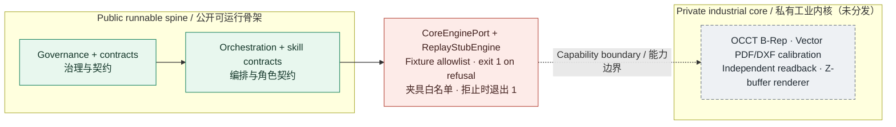

# Industrial CAD Agent Showcase

**Agent-Engineered Dual-Entry CAD Governance & Orchestration Spine**  
**Agent 工程化工业 CAD 双入口编排与可信治理骨架**

[CI configuration · Windows and Ubuntu · Python 3.12](.github/workflows/ci.yml) · **30,588 lines local / ~5,000 lines public spine** · [Core protection · Port and replay stub](cad_agent_showcase/ports/core_engine.py) · [Rights · Source display](RIGHTS-AND-SOURCES.md)

What does it take to build a 30,588-line industrial CAD system with AI agents while keeping unverified model outputs away from the shop floor?

The local system spans 82 core Python modules across a multi-seat concept workflow, a parameter bridge with seven evidence states, and a B-Rep modeling and drawing backend. This repository presents its source-derived Python governance, orchestration, and contract layers. Run the public 25-state workflow, five-seat blind review with v1.1 neutral evidence mapping, and 128-vertex scoring sensitivity checks on fixed synthetic fixtures. Proprietary geometry, calibrated PDF/DXF parsing, and independent engineering readback stay behind `CoreEnginePort`.

怎样用 AI Agent 构建一套 30,588 行的工业 CAD 系统，并阻止未经核验的模型输出进入加工现场？

本地系统的 82 个核心 Python 模块覆盖多席概念工作流、七态参数桥、B-Rep 建模与出图后端。这里展示从同一工程中抽取的 Python 治理、编排和契约层，可用固定合成样例运行公开的 25 态流程、带 v1.1 中性证据映射的五席盲评，以及 128 顶点评分敏感性检查。私有几何内核、PDF/DXF 标定解析和独立工程回读留在 `CoreEnginePort` 另一侧。

[Standalone showcase / 独立展示页](docs/showcase/index.html) · [Architecture / 架构](docs/architecture.md) · [Historical v0.1.0 release / 历史 v0.1.0 版本](https://github.com/SnowEagle-Kn/industrial-cad-agent-showcase/releases/tag/v0.1.0)

Open the showcase locally with the `docs/showcase/` directory intact.  
保留完整的 `docs/showcase/` 目录，在本地浏览器打开展示页。

<a id="overview--项目概览"></a>
## Public and private architecture / 公开层与私有层



The local count is the physical line total for the 82-module baseline. The public estimate counts nonblank lines other than comment-only lines in the governance, orchestration, core port, and replay-stub implementations. Package markers and legacy compatibility wrappers are outside that count.

本地数字为冻结基线 82 个模块的物理行数。公开估值统计治理、编排、核心端口及回放桩实现中的非空、非纯注释行，包标记及旧兼容包装不计入。

The concept route starts with a brief and explicit unknowns. The drawing route starts with a drawing-object inventory in the local stack and its synthetic counterpart in replay. Both use the same revision, confirmation, and delivery bindings.

概念入口从需求简报和明确的未知项开始。图纸入口在本地系统中从图纸对象清单开始，公开回放使用对应的合成记录。双入口共用版本、确认和交付绑定。

## Agent engineering in practice / Agent 工程怎么做

| Failure mode / 常见问题 | Project response / 工程解法 | Source / 源码 |
|---|---|---|
| Workflow drifts across turns / 跨轮状态漂移 | 25 named states, Draft 2020-12 contracts, one runtime policy, and separate verification layers / 25 个具名状态、Draft 2020-12 契约、一份运行策略与独立分层记录 | [State machine](cad_agent_showcase/governance/state_machine.py) · [Contracts](contracts/) |
| Reviewer sees author cues / 评审看到作者线索 | Five isolated design seats and a v1.1 path-safe projection into readable neutral evidence / 五席隔离设计，v1.1 将引用按路径约束投影到可读的中性证据 | [Anonymizer](cad_agent_showcase/governance/anonymize.py) · [Evidence mapping](cad_agent_showcase/governance/neutral_evidence.py) |
| A single score hides uncertainty / 单一分数掩盖不确定性 | Seven interval-valued criteria, 128 shared weight vertices, and explicit ranking reversals / 七维区间评分、128 个共同权重顶点及明确的名次反转条件 | [Scoring](cad_agent_showcase/governance/scoring.py) |
| Generated output appears to attest to itself / 写出文件后用写侧结论自证 | Independent readback as a private engineering pattern and an explicit seven-operation public port / 私有工程采用独立回读，公开层以七操作端口标出边界 | [Port](cad_agent_showcase/ports/core_engine.py) · [Readback decision](docs/adr/04-independent-readback.md) |
| Stale approval or outbox mistaken for delivery / 旧确认或入箱被误用为当前交付 | Revision-bound invalidation and distinct outbox, send, consume, and ACK states / 版本绑定失效，分别登记入箱、发送、消费和 ACK | [Confirmation](cad_agent_showcase/governance/confirm.py) · [Handoff](cad_agent_showcase/orchestration/session_handoff.py) |
| A missing datum or model-generated consent slips through / 缺少数据或模型自签后继续 | G1 holds back insufficient engineering inputs. G2 checks for a separate host event / G1 阻断工程数据缺项，G2 核验独立宿主事件 | [Gates](cad_agent_showcase/orchestration/gating.py) · [Skill contracts](skills/) |

## Synthetic development evidence / 合成开发成果

| Two-hole plate drawing / 双孔板出图 | Repeated-hole plate detail / 重复孔板局部 |
|---|---|
|  |  |
| Complete four-view drawing produced in a synthetic drawing-reconstruction development case, with its original labels. / 合成原图复建开发案例生成的完整四视图，保留原图面标识。 | Lossless 450 × 350 PNG crop. The source sheet is marked `DEVELOPMENT FIXTURE / NOT FOR MANUFACTURE` and contains overlapping view regions. The crop documents the local detail only. / 450 × 350 像素的无损 PNG 摘图。原完整图标有 `DEVELOPMENT FIXTURE / NOT FOR MANUFACTURE`，含视图区交叠。摘图仅证明局部展示内容。 |

Both images are synthetic development outputs prepared before replay. Their documented scope ends at the illustrated development cases.  
两图均为预先生成的合成开发成果，证据范围限所示开发案例。 [Media provenance / 素材来源](docs/showcase/MEDIA.md)

<a id="technical-details--技术说明"></a>
<a id="public-v010-replay--公开-v010-回放包"></a>
## Run it locally / 本地运行验证

From the repository root, use Python 3.12 and keep the package, contracts, fixtures, and examples together. Run the six CLI commands in order or independently.  
在仓库根目录使用 Python 3.12，保留包、契约、夹具和示例目录。下面六条 CLI 命令可依次或独立运行。

```text
python -m cad_agent_showcase demo concept --replay
python -m cad_agent_showcase demo drawing --replay
python -m cad_agent_showcase demo confirmation-mutation --replay
python -m cad_agent_showcase demo eval --replay
python -m cad_agent_showcase demo gates --replay
python -m cad_agent_showcase verify-boundary
python contracts/verify_checklist.py
python -m unittest discover
```

The first five commands exercise the concept path, drawing path, revision invalidation, blind evaluation, and gates. `verify-boundary` exercises the core refusal boundary. It also scans the local distribution. The unit suite includes the [disclosure boundary test](tests/test_disclosure_boundary.py). Exit `0` means the requested scenario matched, including an expected refusal inside a self-check. Exit `1` is a refusal or a disclosure finding, `2` is invalid input, usage, or fixture integrity, and `3` is an engine or replay-stage failure. Replay confirmations carry `replay_simulated` evidence.

前五条分别演练概念链、图纸链、版本变更失效、盲评及门控。`verify-boundary` 演练私有核心拒止边界并扫描本地分发内容。单元测试包括[分发边界测试](tests/test_disclosure_boundary.py)。退出码 `0` 表示场景符合预期，包括自检中的预期拒止。`1` 表示拒止或发现分发边界问题，`2` 表示输入、用法或夹具完整性错误，`3` 表示引擎或回放阶段失败。回放确认标记为 `replay_simulated`。

The repository contains **12 Draft 2020-12 schemas and one runtime policy**. The [checklist verifier](contracts/verify_checklist.py) checks the structure and coverage of the [72-item checklist](contracts/acceptance-checklist-72.json), whose item statuses are all `NOT_RUN`. The [workflow configuration](.github/workflows/ci.yml) defines Windows and Ubuntu jobs. Check the status for the commit you are using. [GitHub Actions / 运行状态](https://github.com/SnowEagle-Kn/industrial-cad-agent-showcase/actions)

仓库包含 **12 份 Draft 2020-12 Schema 和一份运行策略**。核验器检查 72 项清单的结构及覆盖，全部条目状态为 `NOT_RUN`。CI 配置定义 Windows 和 Ubuntu 作业，请按所使用的提交查看运行状态。 [GitHub Actions / 运行状态](https://github.com/SnowEagle-Kn/industrial-cad-agent-showcase/actions)

## Architecture decisions / 工程决策记录

1. [Source-derived spine and ports / 同源骨架与端口隔离](docs/adr/01-source-derived-spine-and-ports.md) — Run the public control flow with a fixed-fixture adapter. / 用固定夹具适配器运行公开控制流。
2. [Blind review and neutral evidence / 盲评与中性证据](docs/adr/02-blind-review-and-neutral-evidence.md) — Keep proof readable while removing author cues. / 清除作者线索并保留证据可读性。
3. [Interval scoring and sensitivity / 区间评分与敏感性](docs/adr/03-interval-scoring-and-sensitivity.md) — Find rankings that can reverse across the weight and score envelope. / 找出在权重与评分区间内可能反转的排序。
4. [Independent readback / 写读独立核对](docs/adr/04-independent-readback.md) — Use a separate reader to catch plausible-looking drawing errors. / 用独立读侧发现外观上难以察觉的出图错误。
5. [Revision binding and handoff / 版本绑定与交接](docs/adr/05-revision-binding-and-handoff.md) — Invalidate old decisions and require separate handoff evidence. / 使旧决策失效并逐阶段核验交接证据。
6. [Schemas, states and verification / 契约、状态与分层验证](docs/adr/06-schema-state-and-verification.md) — Give data shape, workflow transitions, and engineering evidence distinct checks. / 分别核验数据形状、流程迁移与工程证据。

<a id="source-access-and-rights--源码与权利"></a>
## Rights and engineering limits / 权利与工程边界

Source is displayed with rights reserved, subject to applicable law, platform terms and explicit agreements. The [source-display terms](LICENSE-PENDING.md) and [rights and sources](RIGHTS-AND-SOURCES.md) define the permitted scope. A standard open-source license is absent.

源码展示、权利保留，受适用法律、平台条款和明确协议约束。准许范围见[源码展示条款](LICENSE-PENDING.md)与[权利及来源](RIGHTS-AND-SOURCES.md)。许可形式为保留权利的源码展示。

Public runs use fixed synthetic fixtures, pre-generated media, and simulated handoff and confirmation records. Live agents, CAD generation, real user drawings, and manufacturing approval are outside the public scope. The 72-item checklist remains `NOT_RUN`. The engineering flags `verified_truth`, `engineering_approval`, `can_enter_p2`, and `production_approved` remain `false`. [Boundary details / 边界说明](docs/architecture.md)

公开运行限固定合成夹具、预生成素材及模拟交接和确认记录。实时 Agent、工业 CAD 出图、真实用户图纸处理和制造批准均在公开范围之外。72 项清单保持 `NOT_RUN`，四个工程标记 `verified_truth`、`engineering_approval`、`can_enter_p2` 和 `production_approved` 均为 `false`。 [边界说明 / Boundary details](docs/architecture.md)
